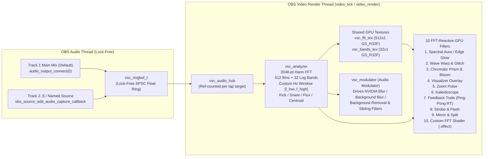

# Visual Sidechain — Implementation Plan

This document defines the architecture, upstream findings, phased implementation steps, test matrix, risk register, and resolved operator decisions for **Visual Sidechain** (`visual-sidechain.dll`), an FFT-reactive GPU shader filter suite and sibling-filter Audio Modulator for OBS Studio 33 on Windows x64 (NVIDIA RTX first).

---

## 1. Local Toolchain & OBS 33 Verification

| Component | Verified Path / Version | Notes |
|---|---|---|
| **Workspace** | `c:\visual-sidechain` (`origin`: `https://github.com/jbrick2070/visual-sidechain`) | Branch `main`, license `GPL-2.0` (`cf2f276`). |
| **OBS Studio 33 SDK** | `C:\Users\jeffr\Documents\obs-playlister\.deps\obs-studio-33.0.0` | Shared read-only prebuilt SDK (`libobs` 33.0.0). |
| **OBS Prebuilt Deps** | `C:\Users\jeffr\Documents\obs-playlister\.deps\obs-deps-2025-08-23-x64` | Shared read-only deps (`w32-pthreads`, etc.). |
| **Portable OBS 33** | `C:\Users\jeffr\OBS-Studio-33-Portable\bin\64bit\obs64.exe` | Target for live smoke & RTX verification. |
| **Compiler / CMake** | Visual Studio 2022 Build Tools (`x64`) + CMake `>= 3.28` | `CMAKE_C_STANDARD 17`, `/W4 /WX`. |
| **C Formatter** | `C:\Program Files (x86)\Microsoft Visual Studio\2022\BuildTools\VC\Tools\Llvm\x64\bin\clang-format.exe` | `LLVM 19.1.5` — run on all `.c`/`.h` before every commit. |

---

## 2. Upstream & OBS 33 Source Audit Findings

### 2.1 `exeldro/obs-shaderfilter` Header & License Audit (`73fb5c2`, v2.6.1)
- **GPL-2.0-only**: Root `LICENSE` is GPL v2 (June 1991). `obs-shaderfilter.c` (3,733 lines) has no license header and no `"or any later version"` clause (lines 1–3 only list attributions for Exeldro, Charles Fettinger, and nleseul). Six shaders in `data/examples/` by SkeletonBow explicitly state `License: GNU General Public License, version 2` with the `"or any later version"` clause omitted.
- **Non-GPL / Shadertoy Contamination in `data/examples/`**: Contains four `CC BY-NC-SA 3.0 Unported` shaders (`intensity-scope.shader`, `page-peel.shader`, `rain-window.shader`, `seascape.shader`) and multiple unattributed Shadertoy ports.
- **Our Policy (`R-LIC-3`)**: We write **100% original `GPL-2.0-or-later` `.effect` shaders** from scratch in `data/effects/`. Zero Shadertoy copies and zero files from `obs-shaderfilter`'s `data/examples/`.

### 2.2 OBS 33 Audio Tap API (`libobs/obs.h`, `libobs/media-io/audio-io.h`)
- **Track 1 (Main Mix) Default (`R-TAP-1`)**:
  - `obs_get_audio()` returns the global `audio_t *`.
  - `audio_output_connect(obs_get_audio(), mixer_idx, NULL, raw_audio_callback, param)` connects directly to **Track 1 (Main Mix)** (`mixer_idx = 0`, our default on every filter) or **Track 2..6** (`mixer_idx = 1..5`) in native `AUDIO_FORMAT_FLOAT_PLANAR`.
- **Named Source Tap (`R-TAP-2`)**:
  - `obs_source_add_audio_capture_callback(source, source_audio_callback, param)` taps any individual audio source (`OBS_SOURCE_AUDIO`) held safely via `obs_weak_source_t`.

### 2.3 OBS 33 NVIDIA RTX Video Effects (`plugins/nv-filters/nvidia-videofx-filter.c`)
- Inspected `C:\Users\jeffr\Documents\obs-playlister\.deps\obs-studio-33.0.0\plugins\nv-filters\nvidia-videofx-filter.c`:
  - **`nv_greenscreen_filter` (NVIDIA Background Removal)**:
    - `S_THRESHOLD` (`"threshold"`, float slider `0.0..1.0`, step `0.05`) — in `nvvfx_filter_update`, changing `threshold` only writes `filter->threshold = threshold` (zero SDK reload cost).
    - `S_PROCESSING_INTERVAL` (`"processing_interval"`, int slider `1..4`) — writes `filter->processing_interval` (zero SDK reload cost).
    - Also outputs an alpha-masked silhouette texture, which our **`vsc_filter_edge_aura` ("FFT Spectral Aura / Edge Glow")** filter can immediately surround with a frequency-mapped neon/spectral outline when placed below Background Removal in the filter stack!
  - **`nv_blur_filter` (NVIDIA Blur)** & **`nv_background_blur_filter` (NVIDIA Background Blur)**:
    - `S_INTENSITY` (`"intensity"`, float slider `0.0..1.0`, step `0.05`) — in `nvvfx_filter_update` (`lines 145–149`), changing `intensity` calls `NvVFX_SetF32` + `NvVFX_Load(filter->handle_blur)`.
    - Our **`vsc_modulator` ("Audio Modulator")** handles this cleanly via per-target batched `obs_source_update`, an epsilon gate (`|new - last| >= 0.002`), and a configurable **Update Rate Divider** (`Every Frame`, `Every 2nd Frame`, `Every 4th Frame`).

---

## 3. Three-Layer Target Architecture

### 3.1 Layer 1 — Pure-C DSP & FFT Core (Zero OBS Headers, 100% Unit-Testable)
- `src/vsc-ringbuf.h` / `src/vsc-ringbuf.c`:
  - Lock-free Single-Producer Single-Consumer (SPSC) float ring buffer (`16384` samples) + multi-channel planar downmixer (`vsc_downmix_planar_to_mono`).
- `src/vsc-fft.h` / `src/vsc-fft.c`:
  - Dependency-free, precomputed-twiddle radix-2 Cooley-Tukey **2048-point real FFT** (`vsc_rfft_2048`) with Hann window table.
- `src/vsc-analyzer.h` / `src/vsc-analyzer.c`:
  - Produces `vsc_audio_snapshot_t`:
    - `raw_mag[1025]`: linear FFT bin magnitudes (`0 Hz .. Fs/2`, `~23.4 Hz`/bin at `48 kHz`)
    - `fft_bins[512]`: smoothed normalized dBFS bins (`0.0..1.0`) for Row 0 of `vsc_fft_tex`
    - `waveform[512]`: latest mono time-domain samples mapped to `0.0..1.0` for Row 1 of `vsc_fft_tex`
    - `bands[32]` & `band_peaks[32]`: 32 logarithmically spaced bands (`20 Hz .. 20 kHz`) for `vsc_bands_tex`
    - Scalars: `level`, `peak`, `sub_bass`, `bass`, `mid`, `high`, `spectral_centroid`, `spectral_flux`, `kick`, `snare`, `beat_phase`
  - Provides `vsc_analyzer_extract_hz_band(&snapshot, sample_rate, freq_low_hz, freq_high_hz, mode)` supporting `VSC_BAND_AVG`, `VSC_BAND_PEAK`, and `VSC_BAND_FLUX` over any custom Hz window.
- `src/vsc-mapping.h` / `src/vsc-mapping.c`:
  - Per-filter / per-slot envelope follower (`attack_ms`, `release_ms`), threshold gate, shaping curves (`Linear`, `Exponential`, `Logarithmic`, `S-Curve`, `Gate`), range mapper (`output_min..output_max`), epsilon gate, and frame-rate divider.
- `src/vsc-effect-parser.h` / `src/vsc-effect-parser.c`:
  - Pure-C lexer/scanner for `.effect` files used by `vsc_filter_custom_shader` to discover user-declared `uniform` parameters (`float`, `int`, `bool`, `float2`, `float4`, UI annotations) and build dynamic OBS property controls.

### 3.2 Layer 2 — Shared Audio & GPU FFT Texture Hub (`src/vsc-audio-hub.h` / `.c`)
- Manages shared subscriptions keyed by source identifier:
  - `"__MAIN_MIX__"` (**Track 1 (Main Mix)** — default!)
  - `"__TRACK_2__"` .. `"__TRACK_6__"`
  - `"__PARENT__:<ptr>"`
  - Named OBS audio source (held via `obs_weak_source_t`)
- Once per render frame (`video_tick`), drains the SPSC ring buffer into `vsc_analyzer`, updates the snapshot, and (inside `obs_enter_graphics()`) updates that tap's shared `vsc_fft_tex` (`512 x 2`, `GS_R32F`) and `vsc_bands_tex` (`32 x 1`, `GS_R32F`) via `gs_texture_set_image`.

### 3.3 Layer 3 — 10 FFT-Reactive GPU Shader Filters + Sibling Audio Modulator
- **`src/vsc-shader-common.h` / `src/vsc-shader-common.c`**:
  - Common base struct and helper functions shared by the 10 GPU shader filters:
    - Populates the standard **"FFT & Audio Reactivity"** UI properties (`Audio Source` defaulting to `Track 1 (Main Mix)`, `FFT Driver` including `Custom Hz Band`, `Low Frequency (Hz)`, `High Frequency (Hz)`, `Band Mode`, `Gain`, `Threshold`, `Attack (ms)`, `Release (ms)`, `Curve`, `Amount`, `Wet/Dry Mix`).
    - Binds `vsc_fft_tex`, `vsc_bands_tex`, `audio_react`, `audio_bass`, `audio_mid`, `audio_high`, `audio_kick`, `audio_snare`, `audio_beat_phase`, `audio_spectral_centroid`, `audio_spectral_flux`, `elapsed_time`, and `uv_size` automatically before drawing.
    - Manages optional ping-pong `gs_texrender_t` render targets for stateful filters (`Feedback Trails`, `Visualizer Waterfall`, `Custom FFT Shader`).
- **The 10 Original `.effect` Shader Filters (`data/effects/*.effect`)**:
  1. `vsc_edge_aura.effect` — **FFT Spectral Aura / Edge Glow** (`vsc_filter_edge_aura`)
  2. `vsc_displacement.effect` — **FFT Wave Warp & Glitch** (`vsc_filter_displacement`)
  3. `vsc_prism.effect` — **FFT Chromatic Prism & Bloom** (`vsc_filter_prism`)
  4. `vsc_visualizer.effect` — **FFT Visualizer Overlay** (`vsc_filter_visualizer`: Bars, Polar Ring, Waterfall Spectrogram, Oscilloscope)
  5. `vsc_zoom_pulse.effect` — **FFT Zoom Pulse** (`vsc_filter_zoom_pulse`)
  6. `vsc_kaleidoscope.effect` — **FFT Kaleidoscope** (`vsc_filter_kaleidoscope`)
  7. `vsc_feedback.effect` — **FFT Feedback Trails** (`vsc_filter_feedback`)
  8. `vsc_strobe.effect` — **FFT Strobe & Flash** (`vsc_filter_strobe`)
  9. `vsc_mirror.effect` — **FFT Mirror & Split** (`vsc_filter_mirror`)
  10. **Custom FFT Shader** (`vsc_filter_custom_shader`) + sample original template `data/effects/vsc_custom_template.effect`.
- **The Sibling-Filter Audio Modulator (`src/vsc-modulator.h` / `src/vsc-modulator.c`)**:
  - `vsc_modulator` ("Visual Sidechain — Audio Modulator"): drives up to 8 numeric properties on sibling filters (including OBS's **NVIDIA Blur**, **NVIDIA Background Blur**, and **NVIDIA Background Removal**) from any FFT custom Hz window or audio feature.

---

## 4. Phased Implementation Plan & Per-Step Verification

### Phase 0 — Requirements, Architecture Plan & Audit (Completed)
- Clone repo, audit `exeldro/obs-shaderfilter` and OBS 33 `nvidia-videofx-filter.c`, author `REQUIREMENTS.md`, `PLAN.md`, and `README.md`, and align on FFT-reactive shader architecture.

### Phase 1 — Build Scaffold, 2048-pt FFT / DSP Engine, Custom Hz Extractor & Unit Tests
- **Step 1.1: CMake & Packaging Scaffold**
  - Create `buildspec.json`, `CMakeLists.txt`, `cmake/windows/*`, `src/plugin-main.c`, `src/plugin-support.h.in`, `data/locale/en-US.ini`, and `THIRD_PARTY_NOTICES.md`.
- **Step 1.2: Lock-Free Ring Buffer & Planar Downmixer (`vsc-ringbuf`)**
  - Implement `vsc_ringbuf_t` and `vsc_downmix_planar_to_mono`.
- **Step 1.3: 2048-pt Real FFT, 512-Bin Texture Mapper, 32 Log Bands & Custom Hz Extractor (`vsc-fft`, `vsc-analyzer`)**
  - Implement radix-2 2048-point real FFT, Hann window, 512-bin dBFS/attack/release smoother, 32 log bands + peak hold, `vsc_analyzer_extract_hz_band` (`Average`, `Peak Bin`, `Spectral Flux`), kick/snare onset detectors, and beat phase tracker.
- **Step 1.4: Envelope Follower, Curve Shaper & `.effect` Uniform Parser (`vsc-mapping`, `vsc-effect-parser`)**
  - Implement `vsc-mapping` and `vsc-effect-parser`.
- **Phase 1 Tests (`ctest`)**:
  - `test_ringbuf`: wrap-around, overflow, multi-channel planar downmix.
  - `test_analyzer`: exact bin peak tests at `50 Hz`, `100 Hz`, `440 Hz`, `1000 Hz`, `8000 Hz`; Custom Hz band isolation (`40..100 Hz` vs `2000..6000 Hz`); Spectral Flux transient spike test; silence decay and NaN/Inf sanitization.
  - `test_mapping`: attack/release timing, shaping curves, epsilon gate, rate divider.
  - `test_effect_parser`: parses uniform declarations and annotations accurately.

### Phase 2 — Shared Audio Hub (Default Track 1 Main Mix) & GPU FFT Textures (`vsc_fft_tex`, `vsc_bands_tex`)
- **Step 2.1: `vsc-audio-hub`**
  - Connect to **Track 1 (Main Mix)** by default via `obs_get_audio()` + `audio_output_connect(..., 0, ...)`, plus Track 2..6, Parent Source, and named `OBS_SOURCE_AUDIO` sources via `obs_weak_source_t`.
  - Upload `vsc_fft_tex` (`512 x 2`, `GS_R32F`) and `vsc_bands_tex` (`32 x 1`, `GS_R32F`) once per render tick per active tap.
- **Step 2.2: `vsc-shader-common`**
  - Shared filter base that binds the FFT textures + scalar uniforms, manages optional ping-pong `gs_texrender_t` targets, and populates the common FFT & Custom Hz UI controls.

### Phase 3 — All 10 Original FFT-Reactive GPU Shader Filters
- **Step 3.1: Core Spatial & Spectral Shaders (Filters 1–4)**
  1. `vsc_filter_edge_aura` (`data/effects/vsc_edge_aura.effect`) — **FFT Spectral Aura / Edge Glow** (alpha cutout & border frequency-mapped glow)
  2. `vsc_filter_displacement` (`data/effects/vsc_displacement.effect`) — **FFT Wave Warp & Glitch** (multi-band UV wave + high-flux glitch slices)
  3. `vsc_filter_prism` (`data/effects/vsc_prism.effect`) — **FFT Chromatic Prism & Bloom** (bass/mid/high RGB prism split + hue shift + bloom)
  4. `vsc_filter_visualizer` (`data/effects/vsc_visualizer.effect`) — **FFT Visualizer Overlay** (Spectrum Bars, Polar Ring, Scrolling Waterfall Spectrogram, Oscilloscope)
- **Step 3.2: Geometric, Temporal & Strobe Shaders (Filters 5–9)**
  5. `vsc_filter_zoom_pulse` (`data/effects/vsc_zoom_pulse.effect`) — **FFT Zoom Pulse** (radial zoom + lens distortion + edge punch)
  6. `vsc_filter_kaleidoscope` (`data/effects/vsc_kaleidoscope.effect`) — **FFT Kaleidoscope** (N-fold mirror symmetry + per-angle FFT bin warp)
  7. `vsc_filter_feedback` (`data/effects/vsc_feedback.effect`) — **FFT Feedback Trails** (ping-pong render target motion echo with FFT decay, zoom drift, and hue shift)
  8. `vsc_filter_strobe` (`data/effects/vsc_strobe.effect`) — **FFT Strobe & Flash** (onset/band-gated brightness, tint, invert, or gate strobe with Max Hz cap)
  9. `vsc_filter_mirror` (`data/effects/vsc_mirror.effect`) — **FFT Mirror & Split** (2-way/4-way/diagonal/slice mirror with FFT slice displacement & beat flip)
- **Step 3.3: Custom FFT Shader Loader (Filter 10)**
  10. `vsc_filter_custom_shader` + `data/effects/vsc_custom_template.effect` — loads any user `.effect` file with automatic `vsc_fft_tex`, `vsc_bands_tex`, `vsc_prev_tex`, and dynamic UI controls.
- **Phase 3 Tests**:
  - `test_effect_parser` validates all 10 shipped `.effect` files in `data/effects/` (syntax, balanced braces, required uniforms, zero banned words, zero BOMs).

### Phase 4 — Sibling-Filter Audio Modulator & NVIDIA RTX Video Effects Verification
- **Step 4.1: `vsc_modulator` ("Visual Sidechain — Audio Modulator")**
  - Enumerates sibling filters on the parent source (`obs_source_enum_filters`), inspects `obs_source_properties` on the UI thread, and drives up to 8 slots from any preset or **Custom FFT Hz Window**, defaulting to **Track 1 (Main Mix)**.
  - Implements batched per-target `obs_source_update`, epsilon change gate (`0.002`), frame-rate divider (`1/2/4`), and baseline restoration.
- **Step 4.2: Portable OBS 33 Deployment & Live Verification**
  - Deploy `visual-sidechain.dll` and `data/obs-plugins/visual-sidechain/` into `C:\Users\jeffr\OBS-Studio-33-Portable` (or verify headless/load log), confirm all 11 filters register cleanly with zero shader compilation errors and zero leaks on exit.

---

## 5. Risks & Mitigations (`R1..R5`)

| ID | Risk | Mitigation |
|---|---|---|
| **`R1`** | `NvVFX_Load` overhead when modulating NVIDIA Blur / Background Blur `intensity` every frame | Batched `obs_source_update` once per target filter per tick, epsilon gate (`0.002`), and per-slot Update Rate Divider (`Every 1 / 2 / 4 Frames`). |
| **`R2`** | HLSL / OBS `.effect` compiler strictness on D3D11 (`gs_effect_create_from_file`) | Use portable OBS `.effect` syntax (`sampler_state`, `VertData`, `texture2d.Sample(textureSampler, uv)`); avoid raw HLSL intrinsics that `libobs`'s effect parser rejects; verify every `.effect` file in OBS 33 D3D11. |
| **`R3`** | Ping-pong render target (`gs_texrender_t`) memory leak or resolution mismatch in Feedback Trails / Waterfall | Resize check on every frame (`cx != prev_cx || cy != prev_cy`), wrap all `gs_*` calls in `obs_enter_graphics()` / `obs_leave_graphics()`, and destroy in `filter_destroy`. |
| **`R4`** | Audio callback firing while a filter or audio source is being destroyed | Reference-counted `vsc_audio_hub` with mutex-guarded subscriber list, atomic active flag, and `obs_weak_source_t` for named sources. |
| **`R5`** | License contamination from third-party shaders | Write 100% original `.effect` shaders under `GPL-2.0-or-later`; never copy from Shadertoy or `obs-shaderfilter/data/examples/`. |
