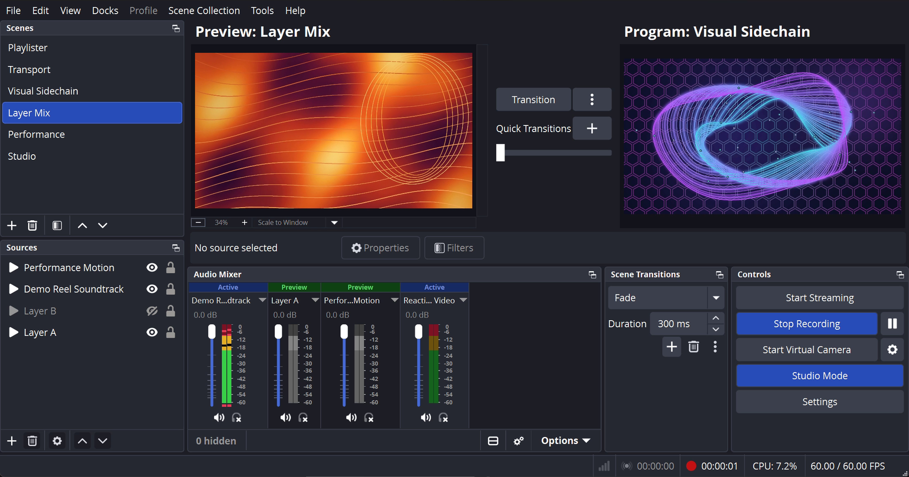

# Visual Sidechain

**Visual Sidechain** makes your video move with your music in OBS Studio 33 on Windows. Its effects react to the sound as it plays, its Audio Modulator moves the settings of your other filters to the beat, and its **[Tape Deck](#tape-deck)** plays a video file at any speed from 25 % to 800 %.



> **Disclaimer:** Visual Sidechain is an independent third-party plugin for OBS Studio. It is not made, endorsed, or supported by the OBS Project or NVIDIA Corporation.

## First five minutes

1. [Install the plugin](#installation-obs-studio-3300-on-windows-x64) and start OBS Studio 33.
2. Right-click a source or a scene, choose **Filters**, press **`+`** under **Effect Filters**, and add **`Visual Sidechain: Shader Filter`**.
3. Play music. The picture moves with the sound on **Track 1 (Main Mix)**. The line at the top of the filter's window says which track it listens to. If nothing moves, check that your music goes to that track: **Audio Mixer**, **Advanced Audio Properties**, **Tracks**.
4. Choose another effect under **`Shader Preset / Mode`**.
5. Open **Settings**, then **Hotkeys**, and set a key for **`Visual Sidechain: Panic (all effects off)`** and one for **`Visual Sidechain: Restore (effects on again)`**. Panic turns off every Visual Sidechain effect in every scene at once.

## Installation (OBS Studio 33.0.0+ on Windows x64)

Download the latest release from [GitHub Releases](https://github.com/jbrick2070/visual-sidechain/releases):

- **Standard Windows Install (`*-Windows-Installer.exe` or `*-Windows.zip`):** Run the installer or extract `visual-sidechain/` into `C:\ProgramData\obs-studio\plugins\` (OBS 33 unified plugin package layout: `visual-sidechain\visual-sidechain.dll` + `visual-sidechain\data\...`).
- **Portable OBS 33 Install (`*-Portable.zip`):** Extract `plugins\visual-sidechain\` directly into the root of your portable OBS Studio 33 folder.
- **Unsigned Binary Note (Windows SmartScreen / Smart App Control):** Release binaries are not Authenticode code-signed. If Windows SmartScreen prompts on the `.exe` installer, click **More info -> Run anyway** (or if unloading a downloaded `.zip`, right-click the `.zip` -> **Properties -> Unblock** before extracting). Systems running Windows 11 **Smart App Control** in strict enforcement mode block unsigned third-party DLLs by OS policy.

## Photosensitivity safety: Panic, Restore and the flash limit

Both hotkeys are in **Settings**, **Hotkeys**, and have no key until you set one. A line in the Shader Filter's window says where to set them.

- **`Visual Sidechain: Panic (all effects off)`** at once puts every `Visual Sidechain: Shader Filter` (custom shaders too) into pass-through and sets every strobe, flash and modulation amount to zero, in every scene. While Panic is on, the top of each Shader Filter and Audio Modulator window says so.
- **`Visual Sidechain: Restore (effects on again)`** ends the pass-through and puts the amounts back as they were before Panic.
- **One process-wide 3 Hz flash clock** caps flashes to at most **3 flashes per second across all Visual Sidechain filters and guarded Audio Modulator slots combined**, admitted in arrival order. In **`FFT Strobe & Flash`**, **`Maximum Flash Rate (Hz)`** can lower that filter's personal limit down to 0.5 Hz (default 3 Hz, never above the 3 Hz global ceiling). Across all 11 built-in shaders, whole-frame brightness, highlight bloom, aura, trail persistence, and edge vignette transients run through `vs_flash_envelope` or `audio_kick_safe` (leaving UV geometry motion raw), and Audio Modulator slots default **`Flash Guard`** to **on** whenever a transient drives brightness, contrast, gamma, opacity, or color settings. Custom shaders cannot be policed automatically—the Properties window notes this next to the shader file picker and code box, and custom shaders can opt into the shared cap with `vs_flash_envelope`, `audio_kick_safe`, `audio_snare_safe`, and `audio_flux_safe`. Your source footage and third-party filters outside Visual Sidechain can still add flashes, so check the final output before you stream, record, or project it, and keep a key on Panic for an instant stop.

## Shader Filter and Audio Modulator

- **`Visual Sidechain: Shader Filter`** applies one of the 11 built-in effects or your own `.shader` / `.effect` file. The **`Effect Mix (Dry / Wet)`** and **`Audio Reactivity`** sliders sit under the preset and need no MIDI hardware. The audio group is at the bottom of the window, with its advanced tuning behind **`Show Advanced Analysis Settings`**. Under **`Fader Control (Midi & Stream Deck Fadester)`** you can bind any Fadester slot (`Crossfader`, `Fader 1..8`, `Master`, `FX 1..8`) to **`Effect Mix Fader (Dry / Wet)`**, **`Audio Reactivity Fader`**, or up to two **`Parameter Fader`** targets (set to the parameter's own range, and held inside its safety limits).
- **`Visual Sidechain: Audio Modulator`** moves numeric settings of another filter on the same source (such as **Color Correction**, **NVIDIA Background Removal** or **NVIDIA Blur**). Add that filter first: the modulator lists only filters on its own source. Each slot follows `Kick Onset`, `Bass`, `Beat Phase`, any `Spectrum Band 1..32`, a `Custom Hz Window`, or a Midi Fadester fader slot, and a **`Depth Fader`** per slot can scale `Modulation Amount` live from `0–100%` from a MIDI fader or a Stream Deck + dial. The minimum and maximum are filled in from the setting's own range when you pick it. When you turn the modulator off or remove it, and when OBS saves the scene collection, each setting goes back to its own value.

## How it works

The coordinated development version is **0.6.0**, shared with Midi Fadester; Fadester for OBS is versioned separately (0.11.0). Install and update each plugin separately; this source version does not create a release tag or replace the operator's hardware/GPU acceptance.

Visual Sidechain is an FFT-reactive GPU shader filter suite and sibling-filter Audio Modulator for OBS Studio 33 on Windows x64 (NVIDIA RTX first). By default it taps **Track 1 (the main mix)** (or any individual OBS audio source / mixer track), runs a real-time dual-resolution Hann-windowed FFT (**4096-point** for high-resolution sub-bass and kick detection $\le 250\text{ Hz}$ paired with **2048-point** for low-latency mids and highs), uploads a `512x2` GPU FFT + waveform texture (`audio_fft`) and a `32x1` logarithmic spectrum texture (`audio_spectrum`), and drives 11 original `GPL-2.0-or-later` FFT-reactive shaders (**FFT Spectral Edge / Border Aura**, **FFT Wave Warp & Glitch**, **FFT Chromatic Prism & Bloom**, **FFT Visualizer Overlays**, **FFT Zoom Pulse & Barrel Lens**, **FFT Kaleidoscope**, **FFT Feedback Trails**, **FFT Strobe & Flash**, **FFT Mirror & Split**, **FFT Hex Pulse Lattice**, and **FFT Polygon Tunnel**) plus the **Audio Modulator** filter for sidechaining sibling filters—including OBS 33's built-in **NVIDIA Blur**, **NVIDIA Background Blur**, and **NVIDIA Background Removal**. All audio and beat signals are also available over the `obs-websocket` 5 vendor API (`vendor_name = "visual-sidechain"`), and all 18 Fadester slots (`crossfader`, `fader_1`..`fader_8`, `master`, `fx_1`..`fx_8`) can act as modulation sources in the Audio Modulator and as float uniforms (`fader_crossfader`, `fader_1`..`fader_8`, `fader_master`, `fader_fx_1`..`fader_fx_8`) in shaders.

## Geometric presets and fader assignments

**FFT Hex Pulse Lattice** draws honeycomb outlines over your source. Bass expands the cells, kick drives a spatial ripple, and highs shift the edge accents. Try a Parameter Fader on the cell density, with the second fader controlling overlay opacity.

**FFT Polygon Tunnel** draws nested polygons with continuous depth motion. Choose three through eight sides, then adjust tunnel depth, travel speed, and rotation. Try binding tunnel depth to a Parameter Fader. Both presets preserve source transparency and remain visible during silence; set audio response to zero for a purely geometric look.

Assignment summaries show the selected fader, destination, and range. Reset buttons affect only their named binding: a parameter reset clears its target and custom range, while a Modulator depth reset keeps the target, driving signal, and amount. Within a Shader Filter, the first parameter assignment owns its target even when it uses the slider value. Within an Audio Modulator, the first enabled slot owns each filter/setting pair. Conflicting choices are disabled, and duplicate assignments loaded from settings are cleared by the existing ownership rules.

Custom shader parameters can use `effect_mix` and `audio_reactivity` independently of the host's percent sliders. Names that collide with internal controls, such as `preset_shader`, `custom_low_hz`, or `vs_effect_mix_pct`, produce a compile message identifying the parameter to rename. A failed shader passes the source through until a valid shader is loaded. In full-effect mode, `vs_effect_mix`, `vs_reactivity_scale` and `vs_flash_envelope` are host-supplied uniforms, so they do not appear as editable shader parameters. `vs_flash_envelope`, `audio_kick_safe`, `audio_snare_safe`, and `audio_flux_safe` (0 to 1) are the shared 3 Hz flash clock's limited transient outputs; a custom shader can use them for brightness, tint, or inversion, and its own `onset_threshold` and `max_flash_rate_hz` parameters, if it declares them, set that shader's trigger threshold and personal rate limit (up to 3 Hz).

## Tape Deck

**`Visual Sidechain: Tape Deck`** turns a Browser Source into a tape deck for a video file on this computer or a network share. Speed runs from 25 % to 800 % and changes in place, picture and sound, with no restart. Nothing is downloaded. (Tubester is its code name in the source tree.)

**First five minutes**

1. Add a new **Browser Source** to a scene, just for the deck. Its address does not matter: the deck sets the source up for itself (the deck page as its address, **Control audio via OBS** on, **Shutdown source when not visible** and **Refresh browser when scene becomes active** off). It does not put the old settings back when you remove the filter, so do not use a Browser Source that shows something else, such as an alert page or a chat. The filter's window says this too.
2. Right-click the Browser Source -> **Filters** -> **Effect Filters (`+`)** -> **`Visual Sidechain: Tape Deck`**.
3. Choose a video file under **Tape**. It plays at once, looping.
4. Move **Speed**. With **Tape pitch** ticked the sound drops and rises with the speed, like a tape; unticked, the pitch stays put.

The status line near the top of the filter's window says what the deck's page last reported, for example "Playing. Speed 150%, at 0:42 of 2:02." It is a snapshot: press **Refresh Status** to read it again. Right after you choose a tape, the window redraws once and the line reads "Loading the tape. Press Refresh Status to see the result." The window never refreshes on a timer, only right after something you do in it, so it never takes the focus while you are editing. If it reads "No answer from the deck page yet", wait a few seconds and press **Refresh Status**. The deck's sound reaches OBS's mixer through the Browser Source.

**Controls**

- **Playing**: untick to pause where the tape is, tick to play on. A paused deck stays paused through a page reload, and loads a new tape paused at its start position. After a tape without **Loop** has ended, it reads Ended until you play it again: press the **Play / Pause** hotkey, or untick and tick **Playing** (it is still ticked after the end). Either starts it from **Start position**.
- **Cue to Start**: goes to **Start position**. A playing deck plays on from there; a paused deck stays paused.
- **Start position** (seconds): where a tape starts when it is loaded, when it is cued, and when it plays again after the end. A start position at or past the end of the tape counts as 0.
- **Speed Fader (Midi & Stream Deck Fadester)**: bind any of the 18 Fadester slots to drive the speed between **Speed at Fader Bottom** and **Speed at Fader Top**. The scale is a ratio: equal fader travel gives an equal speed ratio, so with 50 % at the bottom and 200 % at the top the middle is 100 %. The Speed slider is left as it is, and applies again when you press **Clear Speed Fader**. Without Midi Fadester the slider applies, and the status line under the binding says so.
- **Hotkeys** (Settings -> Hotkeys, listed under the Browser Source's own name): **Tape Deck: Play / Pause** (on a tape that has ended it plays again from the start position), **Cue to Start**, **Speed Up** and **Speed Down** (along 25, 50, 75, 100, 125, 150, 200, 300, 400, 600 and 800 %), and **Normal Speed**. The speed hotkeys move the Speed setting; while a Speed Fader is live, the fader keeps the speed. Bindings are saved with the source, and a deck you remove and bring back with Undo keeps them.

**Two decks, hidden decks.** Each Browser Source holds one deck. A second Tape Deck on the same source waits and says so, and takes over if the first is removed (with whatever hotkey bindings the source last saved). A deck whose source is hidden keeps its tape loaded and playing, without sound. Visual Sidechain's Panic and Restore leave decks alone.

**What plays.** With picture and seeking: H.264 in MP4, MKV and MOV (also 10-bit and 4:2:2), VP9 in WebM, AV1 in MP4, and HEVC in MP4 where this PC's hardware decodes it. Sound plays from AAC, MP3 and Opus; AC-3 gives picture without sound. MPEG-2, MJPEG and DXV files give "Cannot play this file", and MPEG-4 Part 2, Theora and ProRes play sound only ("This file plays sound only"). A missing file also gives "Cannot play this file". Convert the others to MP4 (H.264 video, AAC sound) with FFmpeg, for example:

```bash
ffmpeg -i input.mov -c:v libx264 -crf 18 -preset slow -pix_fmt yuv420p -c:a aac -b:a 192k -movflags +faststart output.mp4
```

**From a Stream Deck or OpenDeck dial (Fadester for OBS).** Add an **OBS Filter** action, choose the Browser Source and its **Tape Deck** filter, pick the setting **`speed_percent`**, and give the range **From 25 To 800** with **Whole numbers** on. The dial then rides the speed in a straight line; pressing it drops the deck to 25 % while held. Fadester for OBS needs no change for this. For the ratio scale, bind the slot as a Speed Fader instead (above). Do not do both for one deck: while the Speed Fader is live, the dial only changes the Speed setting, which applies once the fader is cleared.

**Over `obs-websocket`.** `SetSourceFilterSettings` on the deck filter accepts `tape` (a full path), `speed_percent` (25 to 800), `tape_pitch`, `loop`, `start_seconds`, `playing`, `speed_fader_slot` (-1 for none, 0 to 17 in the order crossfader, fader 1 to 8, master, FX 1 to 8), `speed_fader_min_percent` and `speed_fader_max_percent`. `TriggerHotkeyByName` reaches the hotkeys: `hotkeyName` is `tubester_deck.play_pause`, `tubester_deck.cue_to_start`, `tubester_deck.speed_up`, `tubester_deck.speed_down` or `tubester_deck.normal_speed`, and `contextName` is the Browser Source's name. To play an ended tape again over obs-websocket, trigger `tubester_deck.play_pause`. Writing `playing` false and then true works only if the deck has taken the first write before the second arrives: OBS applies a filter's settings once per frame, so two quick writes merge into one with no change. Wait until `get_decks` shows `playing: false` before writing true. `get_decks` (below) reads every deck's state. The deck writes one more setting itself, `hotkey_bindings`, a copy of its hotkey bindings; leave it alone.

## `obs-websocket` 5 Vendor API

### Midi Fadester and Stream Deck integration

Midi Fadester 0.4.0 and Fadester for OBS expose an 18-slot desk. All 18 slots are available as Shader Filter mix/reactivity/parameter controls and Audio Modulator signal/depth sources. Existing saved fader indices `0..9` and modulation signal IDs `200..209` stay unchanged; the FX bank appends indices `10..17` and signal IDs `210..217`. The in-process bridge uses the same slot IDs as Stream Deck. Older Midi Fadester providers continue to supply their ten legacy slots; unsupported FX slots read zero.

For setup from the Stream Deck Property Inspector, assign a Midi slot to **Filter setting (FX)**, select the Visual Sidechain filter, then choose a numeric setting from its catalog. Audio Modulator depth trims are `slot_1_amount_pct` through `slot_8_amount_pct`: choose **At 0 % = 0** and **At 100 % = 100** to remove audio-driven movement at the zero rail. Amount zero holds the modulator target at its configured Minimum; choose that Minimum as the desired neutral setting. The property itself supports `-100..100`; using that full range makes the zero rail maximum ducking. For ducking, keep a negative Modulation Amount and bind a Depth Fader instead of sweeping the amount across zero, so zero depth retains the Maximum endpoint of the ducking branch. Shader Filter's host percent controls are `vs_effect_mix_pct` and `vs_audio_reactivity_pct`; custom numeric shader parameters also appear in the catalog.

Midi's **Clean / All FX Off** resets enabled `filter_param` bindings in either bank to their configured zero endpoint. It does not reset arbitrary audio/layer assignments or invoke Visual Sidechain's separate global **Panic / Restore** state. A numeric trim reset changes that trim; enabling **Bypass at 0 %** additionally bypasses the entire target filter, with shared ownership managed by Midi Fadester. Avoid assigning two control paths to the same setting: use either the filter's internal fader assignment or a Midi `filter_param` binding for that setting.

- **Vendor Name:** `"visual-sidechain"`
- **Request:** `CallVendorRequest` with `vendorName: "visual-sidechain"`, `requestType: "get_signals"` returns `{ success, version, api_version: 1, level, sub_bass, bass, mid, high, kick, snare, beat, beat_phase, spectral_centroid, spectral_flux, estimated_bpm, bpm, spectrum: [{ band: 0..31, value }] }`.
- **Event:** `VendorEvent` (`vendorName: "visual-sidechain"`, `eventType: "signals_changed"`) streams the same payload coalesced to at most 30 events/sec.
- **Request:** `requestType: "get_decks"` returns every Tape Deck as its page last reported it: `{ success, api_version: 1, decks: [{ source, filter, deck_id, role, state, tape, speed_percent, effective_speed_percent, speed_fader, tape_pitch, playing, loop, start_seconds, linked, reported? }] }`. `playing` is the Playing setting; `state` and `reported` say what the page does. `speed_percent` is the Speed setting; `effective_speed_percent` is the speed the deck asks for, which is the Speed Fader's while that fader is live. `speed_fader` is `{ slot, slot_id, min_percent, max_percent, live }`: `slot` is -1 and `slot_id` empty when no fader is bound, and `live` is true while the bound fader drives the speed. `role` is `owner`, `waiting` (another deck drives that Browser Source), `pending`, `wrong_parent` or `detached`. `reported` (`current_tape, rate, position, duration, paused, ended, ready_state, error, no_picture`) is present only while `linked` is true; `current_tape` is false while it still describes an earlier tape. Read-only: change a deck with `SetSourceFilterSettings`.

## Languages

Visual Sidechain follows the language OBS runs in (Settings > General > Language; OBS needs a restart to change it). Besides English it speaks Simplified Chinese, Spanish, Brazilian Portuguese, Russian, Japanese, German, French, Korean, Traditional Chinese, Turkish and Dutch. A few strings start from OBS's own translation; the rest was drafted by an AI model (Claude), and every file was reviewed by a second one (Gemini), whose corrections were taken. No native speaker has checked them yet. If something reads wrong in your language, please open an issue or a pull request: the files are in `data/locale/`, one per language, and `en-US.ini` is the English source. The built-in effects' parameter names and tooltips are translated too (the `ShaderParam.*` lines); a custom shader's own names stay as written in its file. Log lines stay English.

## Development & AI Disclosure

This project is written with AI coding tools and reviewed and tested by the author on OBS Studio 33. All bundled shaders are original `GPL-2.0-or-later` implementations with no Shadertoy copies.

## Documentation & Beta Feedback

- **[BETA-TESTING.md](BETA-TESTING.md)** — **10-minute Beta Tester Guide & Hardware Checklist** for OBS Studio 33 ([Submit a Beta Report](https://github.com/jbrick2070/visual-sidechain/issues/new?template=beta-feedback.yml)).
- [REQUIREMENTS.md](REQUIREMENTS.md) — Functional, dual-FFT/DSP, GPU shader, NVIDIA RTX modulator, baseline save-protection, threading, licensing, and testing requirements (`R-*`) and decisions (`D-1..D-4`).
- [PLAN.md](PLAN.md) — Phased implementation plan, OBS 33 & upstream audit findings, 3-layer architecture, per-step named tests and mutation checks, risk register, and verify-at-build checklist.
- [TESTING.md](TESTING.md) — Headless CTest, mutation-check, and live OBS Studio 33.0.0 hardware verification results.
- [LICENSE](LICENSE) — GNU General Public License v2.0.

## License

Visual Sidechain is licensed under the **GNU General Public License v2.0 or later (GPL-2.0-or-later)**.

This is because Visual Sidechain is an OBS Studio plugin:

- It loads directly into the OBS Studio process and links against **libobs**, which is licensed under GPL-2.0.
- It is built from the official **OBS Plugin Template**, which is also GPL-2.0.

To stay compatible with OBS Studio, Visual Sidechain uses the same license. You are free to use, study, modify, and share it. If you distribute a modified version, it must stay open source under the GPL. See [LICENSE](LICENSE).
